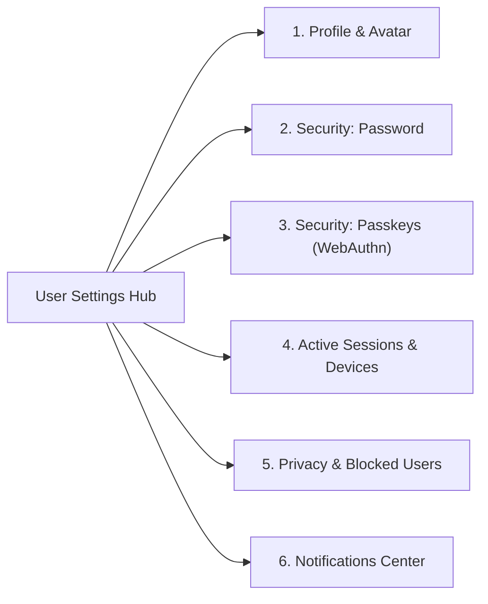
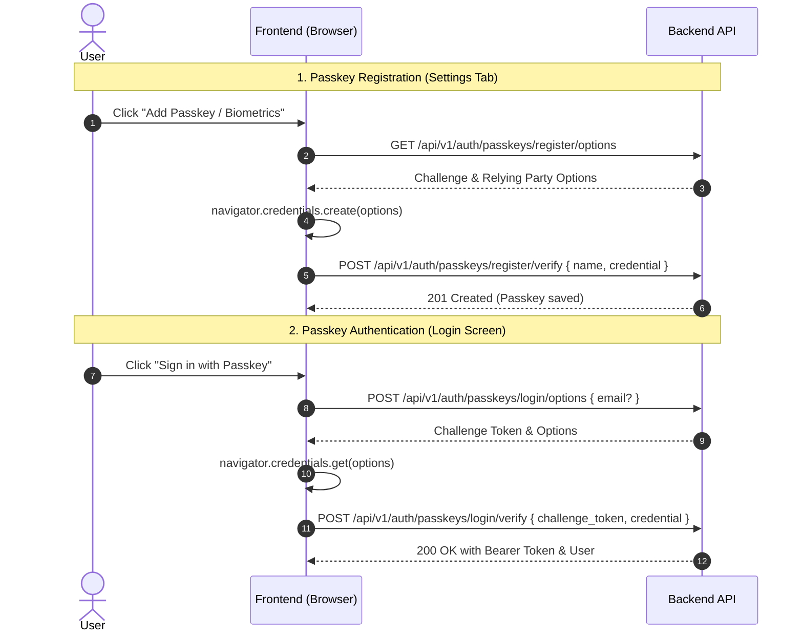

# Unified Frontend Settings Integration Guide

A complete, production-ready architectural and API integration guide for building the entire **User Settings** hub in modern frontend frameworks (React, Next.js, Vue, Nuxt, Svelte, or Mobile Apps).

---

## Settings Hub Architecture

Recommended tab and section structure:



---

## Global Headers & Authentication

All settings endpoints require the user to be authenticated via a Sanctum Bearer token:

```http
Authorization: Bearer <access_token>
Accept: application/json
```

For JSON payloads:
```http
Content-Type: application/json
```

---

## 1. Profile & Avatar Management

### Endpoints

| Method | Endpoint | Content-Type | Description |
| :--- | :--- | :--- | :--- |
| `GET` | `/api/v1/profile` | — | Fetch current user's profile information. |
| `PUT` | `/api/v1/profile` | `application/json` | Update user name, username, and/or email. |
| `POST` | `/api/v1/profile/avatar` | `multipart/form-data` | Upload and replace profile image. |
| `GET` | `/api/v1/profile/stats` | — | Fetch user statistics (memorials, comments, likes). |

---

### A. Fetch Profile (`GET /api/v1/profile`)

#### Success Response (`200 OK`)
```json
{
  "success": true,
  "message": "Success",
  "data": {
    "id": 1,
    "name": "Alex Morgan",
    "username": "alexmorgan",
    "email": "alex@example.com",
    "avatar": "https://example.com/storage/avatars/random.webp",
    "role": "user",
    "badge": "Pet Guardian",
    "email_verified": true,
    "created_at": "2026-10-15T08:00:00.000000Z",
    "updated_at": "2026-10-29T10:00:00.000000Z"
  }
}
```

---

### B. Update Profile Details (`PUT /api/v1/profile`)

#### Request Body
```json
{
  "name": "Alex Morgan",
  "username": "alex_morgan",
  "email": "alex.new@example.com"
}
```

All fields are optional (`sometimes`). Send only the fields you wish to update.

> [!IMPORTANT]
> **Email Change Behavior**:
> If the `email` is changed to a new address, the server automatically:
> 1. Sets `email_verified` to `false` (`email_verified_at = null`).
> 2. Generates an OTP code and sends an `EmailVerificationOtpNotification` to the new email address.
> 3. The frontend should prompt the user to enter the OTP code (`POST /api/v1/auth/email/verify`) or resend it (`POST /api/v1/auth/email/resend`).

#### Validation Errors (`422 Unprocessable Content`)
- Duplicate username: `errors.username = ["The username has already been taken."]`
- Duplicate email: `errors.email = ["The email has already been taken."]`
- Invalid username format: `errors.username = ["The username field must only contain letters, numbers, dashes, and underscores."]`

---

### C. Update Avatar (`POST /api/v1/profile/avatar`)

Must be sent as `multipart/form-data`.

#### Request Payload
- Form key: `avatar`
- Type: `File` (Image: jpg, jpeg, png, webp)

```typescript
const formData = new FormData();
formData.append('avatar', fileInput.files[0]);

await fetch('/api/v1/profile/avatar', {
  method: 'POST',
  headers: {
    'Authorization': `Bearer ${token}`,
    'Accept': 'application/json',
  },
  body: formData,
});
```

---

## 2. Security: Change Password

### Endpoint: `PUT /api/v1/profile/password`

> [!NOTE]
> This endpoint uses standard JSON (`application/json`) with `PUT`. Do not use `multipart/form-data` or `POST` since there are no image/file uploads involved.

### Request Payload
```json
{
  "current_password": "existing_secret_password",
  "password": "brand_new_secret_password",
  "password_confirmation": "brand_new_secret_password"
}
```

### Field Specifications & Validation Rules

| Field | Type | Required | Constraints | Description |
| :--- | :--- | :--- | :--- | :--- |
| `current_password` | `string` | **Yes** | Must match the user's current password. | Verified server-side against password hash. |
| `password` | `string` | **Yes** | Min 8 chars; Must be confirmed; Must be different from `current_password`. | The new password. |
| `password_confirmation`| `string` | **Yes** | Must exactly match `password`. | Password confirmation input. |

### API Responses

#### Success Response (`200 OK`)
```json
{
  "success": true,
  "message": "Password updated successfully",
  "data": null
}
```

> [!IMPORTANT]
> **Security & Session Behavior**:
> When a user successfully updates their password, **their current device's session remains active** (the current token is preserved). However, **all other active sessions/tokens on other devices are automatically revoked** for security. The user does not need to re-login on the device where they made the change.

#### Validation Errors (`422 Unprocessable Content`)

- **Wrong Current Password**:
  ```json
  {
    "success": false,
    "message": "The provided password does not match your current password.",
    "errors": {
      "current_password": ["The provided password does not match your current password."]
    }
  }
  ```

- **New Password Same As Current Password**:
  ```json
  {
    "success": false,
    "message": "The password and current password must be different.",
    "errors": {
      "password": ["The password and current password must be different."]
    }
  }
  ```

- **Password Confirmation Mismatch**:
  ```json
  {
    "success": false,
    "message": "The password field confirmation does not match.",
    "errors": {
      "password": ["The password field confirmation does not match."]
    }
  }
  ```

- **Password Too Short (< 8 characters)**:
  ```json
  {
    "success": false,
    "message": "The password field must be at least 8 characters.",
    "errors": {
      "password": ["The password field must be at least 8 characters."]
    }
  }
  ```

---

## 3. Security: Passkeys (WebAuthn / Biometrics)

Passkeys allow users to sign in with Face ID, Touch ID, Windows Hello, or hardware security keys (YubiKey) without passwords.

### Passkeys Lifecycle Flow



### Endpoints

| Method | Endpoint | Description |
| :--- | :--- | :--- |
| `GET` | `/api/v1/auth/passkeys` | List all passkeys registered for current user. |
| `GET` | `/api/v1/auth/passkeys/register/options` | Generate WebAuthn creation options & challenge. |
| `POST` | `/api/v1/auth/passkeys/register/verify` | Verify and save the newly created passkey. |
| `PATCH` | `/api/v1/auth/passkeys/{id}` | Rename a passkey (e.g., "Work MacBook"). |
| `DELETE` | `/api/v1/auth/passkeys/{id}` | Delete a registered passkey. |

---

### A. List Passkeys (`GET /api/v1/auth/passkeys`)

#### Response (`200 OK`)
```json
{
  "success": true,
  "message": "Success",
  "data": [
    {
      "id": 12,
      "name": "MacBook Pro Touch ID",
      "authenticator": "Apple Touch ID",
      "last_used_at": "2026-10-28T14:32:00.000000Z",
      "created_at": "2026-10-01T09:15:00.000000Z"
    }
  ]
}
```

---

### B. Registering a Passkey using `@laravel/passkeys` (Recommended)

Install Laravel's official first-party client:

```bash
npm install @laravel/passkeys
```

> [!TIP]
> **Why `@laravel/passkeys`?**
> - Official first-party library backed by `@simplewebauthn/browser`.
> - Eliminates manual base64 conversions and raw `navigator.credentials` ceremonies.
> - First-class React, Vue, and Svelte framework adapters.
> - Typed error instances (`UserCancelledError`, `PasskeyExistsError`, `NotSupportedError`).

#### 1. Core / TypeScript Implementation (`Passkeys` Class)

```typescript
import { Passkeys, PasskeyExistsError, UserCancelledError, NotSupportedError } from '@laravel/passkeys';

export async function registerNewPasskey(token: string, friendlyName: string) {
  // 1. Configure Bearer token header for API requests
  Passkeys.configure({
    fetch: {
      headers: {
        Authorization: `Bearer ${token}`,
      },
    },
  });

  try {
    // 2. Perform the full WebAuthn ceremony with route overrides
    const response = await Passkeys.register({
      name: friendlyName,
      routes: {
        options: '/api/v1/auth/passkeys/register/options',
        submit: '/api/v1/auth/passkeys/register/verify',
      },
    });

    return response;
  } catch (error) {
    if (error instanceof UserCancelledError) {
      console.warn('User dismissed the native biometric prompt.');
    } else if (error instanceof PasskeyExistsError) {
      console.error('This device/key is already registered as a passkey.');
    } else if (error instanceof NotSupportedError) {
      console.error('Passkeys are not supported on this browser or platform.');
    } else {
      console.error('Failed to register passkey:', error);
    }
    throw error;
  }
}
```

#### 2. React Hook Form Component (`@laravel/passkeys/react`)

```tsx
import React, { useState } from 'react';
import { Passkeys, PasskeyExistsError } from '@laravel/passkeys';
import { usePasskeyRegister } from '@laravel/passkeys/react';

export function AddPasskeySection({ token, onPasskeyAdded }: { token: string; onPasskeyAdded: () => void }) {
  const [name, setName] = useState('');

  // Configure Bearer token for client requests
  Passkeys.configure({
    fetch: {
      headers: {
        Authorization: `Bearer ${token}`,
      },
    },
  });

  const { register, isLoading, error, errorInstance } = usePasskeyRegister({
    routes: {
      options: '/api/v1/auth/passkeys/register/options',
      submit: '/api/v1/auth/passkeys/register/verify',
    },
    onSuccess: () => {
      setName('');
      onPasskeyAdded();
    },
  });

  return (
    <div className="p-4 border rounded-lg bg-white space-y-3">
      <h4 className="font-medium text-gray-900">Add Passkey / Biometric Login</h4>
      <p className="text-sm text-gray-500">
        Use Touch ID, Face ID, Windows Hello, or a security key for instant, passwordless sign-in.
      </p>

      <div className="flex gap-2">
        <input
          type="text"
          value={name}
          onChange={(e) => setName(e.target.value)}
          placeholder="Device name (e.g. MacBook Pro, Work Phone)"
          className="border rounded px-3 py-2 text-sm flex-1"
        />
        <button
          type="button"
          onClick={() => register(name)}
          disabled={isLoading || !name.trim()}
          className="px-4 py-2 bg-blue-600 text-white text-sm font-medium rounded hover:bg-blue-700 disabled:opacity-50"
        >
          {isLoading ? 'Scanning Biometrics...' : 'Register Passkey'}
        </button>
      </div>

      {errorInstance instanceof PasskeyExistsError ? (
        <p className="text-xs text-amber-600">This biometric device is already registered on your account.</p>
      ) : error ? (
        <p className="text-xs text-red-500">{error}</p>
      ) : null}
    </div>
  );
}
```

---

### C. Direct Integration with `@simplewebauthn/browser` (Alternative)

If you prefer using `@simplewebauthn/browser` directly without the `@laravel/passkeys` wrapper:

```bash
npm install @simplewebauthn/browser
```

```typescript
import { startRegistration } from '@simplewebauthn/browser';

export async function registerPasskeyWithSimpleWebAuthn(token: string, friendlyName: string) {
  // 1. Fetch registration options from backend
  const optionsRes = await fetch('/api/v1/auth/passkeys/register/options', {
    headers: { Authorization: `Bearer ${token}`, Accept: 'application/json' },
  });
  const { data: options } = await optionsRes.json();

  // 2. Perform WebAuthn ceremony (auto-handles base64 conversions)
  const credential = await startRegistration({ optionsJSON: options });

  // 3. Send verification payload to backend
  const verifyRes = await fetch('/api/v1/auth/passkeys/register/verify', {
    method: 'POST',
    headers: {
      Authorization: `Bearer ${token}`,
      'Content-Type': 'application/json',
      Accept: 'application/json',
    },
    body: JSON.stringify({
      name: friendlyName,
      credential,
    }),
  });

  return await verifyRes.json();
}
```

---

## 4. Active Sessions & Device Management (Session Track System)

The Session Track System allows users to review every device and browser currently logged into their account, inspect IP addresses and activity timestamps, and revoke access remotely.

### Endpoints

| Method | Endpoint | Description |
| :--- | :--- | :--- |
| `GET` | `/api/v1/profile/sessions` | List all active sessions with device names, IPs, and current device indicator. |
| `DELETE` | `/api/v1/profile/sessions/{id}` | Revoke a single active session by its ID. |
| `DELETE` | `/api/v1/profile/sessions` | Revoke **all other sessions** except the current device. |

---

### A. Fetch Active Sessions (`GET /api/v1/profile/sessions`)

#### Response (`200 OK`)
```json
{
  "success": true,
  "message": "Active sessions retrieved successfully",
  "data": [
    {
      "id": 142,
      "device_name": "Chrome on OS X",
      "ip_address": "192.168.1.50",
      "is_current": true,
      "last_active_at": "2026-10-29T10:45:00.000000Z",
      "created_at": "2026-10-29T08:12:00.000000Z"
    },
    {
      "id": 139,
      "device_name": "iPhone (Safari)",
      "ip_address": "172.56.21.84",
      "is_current": false,
      "last_active_at": "2026-10-28T22:15:30.000000Z",
      "created_at": "2026-10-25T14:00:00.000000Z"
    },
    {
      "id": 128,
      "device_name": "Edge on Windows",
      "ip_address": "192.168.1.120",
      "is_current": false,
      "last_active_at": "2026-10-24T19:30:00.000000Z",
      "created_at": "2026-10-20T11:45:00.000000Z"
    }
  ]
}
```

> [!TIP]
> **Highlighting Current Device**:
> Use `is_current: true` to display a distinct badge (`"Current Session"` / `"This Device"`) and disable the revoke button for that row (direct the user to "Log Out" instead).

---

### B. Device Naming during Login

When logging in or registering, the frontend can pass an optional `device_name` to make the session list easy to recognize:

```json
{
  "email": "user@example.com",
  "password": "password123",
  "device_name": "Alex's MacBook Pro (Work)"
}
```
*If `device_name` is omitted, the API automatically resolves the device, browser, and operating system using package-backed device detection (e.g. `"Chrome on OS X"`, `"iPhone (Safari)"`, `"Edge on Windows"`).*

---

### C. Revoke a Specific Session (`DELETE /api/v1/profile/sessions/{id}`)

```typescript
export async function revokeSession(token: string, sessionId: number) {
  const response = await fetch(`/api/v1/profile/sessions/${sessionId}`, {
    method: 'DELETE',
    headers: {
      'Authorization': `Bearer ${token}`,
      'Accept': 'application/json',
    },
  });

  return await response.json();
}
```

---

### D. Log Out from All Other Devices (`DELETE /api/v1/profile/sessions`)

Terminates all sessions except the one making the request.

```typescript
export async function revokeAllOtherSessions(token: string) {
  const response = await fetch('/api/v1/profile/sessions', {
    method: 'DELETE',
    headers: {
      'Authorization': `Bearer ${token}`,
      'Accept': 'application/json',
    },
  });

  return await response.json();
}
```

---

## 5. Privacy & Blocked Users

Allows users to manage who they have blocked from viewing their profile, memorials, and stories.

### Endpoints

| Method | Endpoint | Description |
| :--- | :--- | :--- |
| `GET` | `/api/v1/users/blocked` | List all users blocked by the current user. |
| `POST` | `/api/v1/users/{user}/block` | Block a specific user. |
| `DELETE` | `/api/v1/users/{user}/block` | Unblock a user. |

---

## 6. Notifications Center

### Endpoints

| Method | Endpoint | Description |
| :--- | :--- | :--- |
| `GET` | `/api/v1/notifications` | Paginated list of notifications. |
| `GET` | `/api/v1/notifications/count` | Unread notifications count badge (`{ count: 3 }`). |
| `POST` | `/api/v1/notifications/{id}/read` | Mark a specific notification as read. |
| `POST` | `/api/v1/notifications/read-all` | Mark all notifications as read. |

---

## 7. Complete TypeScript Interfaces

```typescript
export interface ApiResponse<T = null> {
  success: boolean;
  message: string;
  data: T;
  errors?: Record<string, string[]>;
}

export interface UserProfile {
  id: number;
  name: string;
  username: string;
  email: string;
  avatar: string | null;
  role: 'admin' | 'user';
  badge: string;
  email_verified: boolean;
  created_at: string;
  updated_at: string;
}

export interface UserStats {
  memorials_count: number;
  comments_count: number;
  likes_count: number;
}

export interface ChangePasswordPayload {
  current_password: string;
  password: string;
  password_confirmation: string;
}

export interface UserSession {
  id: number;
  device_name: string;
  ip_address: string | null;
  is_current: boolean;
  last_active_at: string;
  created_at: string;
}

export interface UserPasskey {
  id: number;
  name: string;
  authenticator: string | null;
  last_used_at: string | null;
  created_at: string;
}

export interface BlockedUserItem {
  id: number;
  user: {
    id: number;
    name: string;
    username: string;
    avatar: string | null;
  };
  blocked_at: string;
}
```

---

## 8. Frontend Component Implementations

### Change Password Form (React Hook Form + Axios)

```tsx
import React, { useState } from 'react';
import { useForm } from 'react-hook-form';
import axios, { AxiosError } from 'axios';
import { ChangePasswordPayload, ApiResponse } from './types';

export function ChangePasswordSection({ token }: { token: string }) {
  const [successMessage, setSuccessMessage] = useState<string | null>(null);
  const { register, handleSubmit, setError, reset, formState: { errors, isSubmitting } } = useForm<ChangePasswordPayload>();

  const onSubmit = async (data: ChangePasswordPayload) => {
    setSuccessMessage(null);
    try {
      const response = await axios.put<ApiResponse<null>>('/api/v1/profile/password', data, {
        headers: {
          Authorization: `Bearer ${token}`,
          Accept: 'application/json',
        },
      });

      setSuccessMessage(response.data.message);
      reset();
    } catch (err) {
      const error = err as AxiosError<ApiResponse<null>>;
      if (error.response?.status === 422 && error.response.data.errors) {
        Object.entries(error.response.data.errors).forEach(([field, messages]) => {
          setError(field as keyof ChangePasswordPayload, {
            type: 'server',
            message: messages[0],
          });
        });
      }
    }
  };

  return (
    <form onSubmit={handleSubmit(onSubmit)} className="max-w-md space-y-4">
      {successMessage && (
        <div className="p-3 bg-green-50 text-green-700 border border-green-200 rounded">
          {successMessage}
        </div>
      )}

      <div>
        <label className="block text-sm font-medium text-gray-700">Current Password</label>
        <input
          type="password"
          {...register('current_password', { required: 'Current password is required' })}
          className="mt-1 block w-full rounded border-gray-300 shadow-sm p-2"
        />
        {errors.current_password && (
          <p className="text-red-500 text-xs mt-1">{errors.current_password.message}</p>
        )}
      </div>

      <div>
        <label className="block text-sm font-medium text-gray-700">New Password</label>
        <input
          type="password"
          {...register('password', {
            required: 'New password is required',
            minLength: { value: 8, message: 'Must be at least 8 characters' },
          })}
          className="mt-1 block w-full rounded border-gray-300 shadow-sm p-2"
        />
        {errors.password && (
          <p className="text-red-500 text-xs mt-1">{errors.password.message}</p>
        )}
      </div>

      <div>
        <label className="block text-sm font-medium text-gray-700">Confirm New Password</label>
        <input
          type="password"
          {...register('password_confirmation', { required: 'Please confirm password' })}
          className="mt-1 block w-full rounded border-gray-300 shadow-sm p-2"
        />
        {errors.password_confirmation && (
          <p className="text-red-500 text-xs mt-1">{errors.password_confirmation.message}</p>
        )}
      </div>

      <button
        type="submit"
        disabled={isSubmitting}
        className="px-4 py-2 bg-blue-600 text-white rounded hover:bg-blue-700 disabled:opacity-50"
      >
        {isSubmitting ? 'Updating...' : 'Update Password'}
      </button>
    </form>
  );
}
```

---

### Active Sessions / Device Management List (React)

```tsx
import React, { useEffect, useState } from 'react';
import axios from 'axios';
import { UserSession, ApiResponse } from './types';

export function ActiveSessionsList({ token }: { token: string }) {
  const [sessions, setSessions] = useState<UserSession[]>([]);
  const [loading, setLoading] = useState(true);

  const fetchSessions = async () => {
    try {
      const res = await axios.get<ApiResponse<UserSession[]>>('/api/v1/profile/sessions', {
        headers: { Authorization: `Bearer ${token}` },
      });
      setSessions(res.data.data);
    } finally {
      setLoading(false);
    }
  };

  useEffect(() => {
    fetchSessions();
  }, []);

  const handleRevokeSingle = async (sessionId: number) => {
    await axios.delete(`/api/v1/profile/sessions/${sessionId}`, {
      headers: { Authorization: `Bearer ${token}` },
    });
    setSessions(prev => prev.filter(s => s.id !== sessionId));
  };

  const handleRevokeOthers = async () => {
    await axios.delete('/api/v1/profile/sessions', {
      headers: { Authorization: `Bearer ${token}` },
    });
    setSessions(prev => prev.filter(s => s.is_current));
  };

  if (loading) return <div>Loading active sessions...</div>;

  return (
    <div className="space-y-4">
      <div className="flex justify-between items-center">
        <h3 className="text-lg font-semibold">Active Devices & Sessions</h3>
        {sessions.filter(s => !s.is_current).length > 0 && (
          <button
            onClick={handleRevokeOthers}
            className="text-sm px-3 py-1 bg-red-50 text-red-600 rounded border border-red-200 hover:bg-red-100"
          >
            Log out from all other devices
          </button>
        )}
      </div>

      <ul className="divide-y divide-gray-200">
        {sessions.map(session => (
          <li key={session.id} className="py-3 flex justify-between items-center">
            <div>
              <div className="flex items-center space-x-2">
                <span className="font-medium text-gray-900">{session.device_name}</span>
                {session.is_current && (
                  <span className="text-xs px-2 py-0.5 bg-green-100 text-green-800 rounded-full font-semibold">
                    Current Device
                  </span>
                )}
              </div>
              <p className="text-xs text-gray-500 mt-1">
                IP: {session.ip_address ?? 'Unknown'} • Last active: {new Date(session.last_active_at).toLocaleString()}
              </p>
            </div>

            {!session.is_current && (
              <button
                onClick={() => handleRevokeSingle(session.id)}
                className="text-xs text-red-500 hover:underline"
              >
                Revoke
              </button>
            )}
          </li>
        ))}
      </ul>
    </div>
  );
}
```
